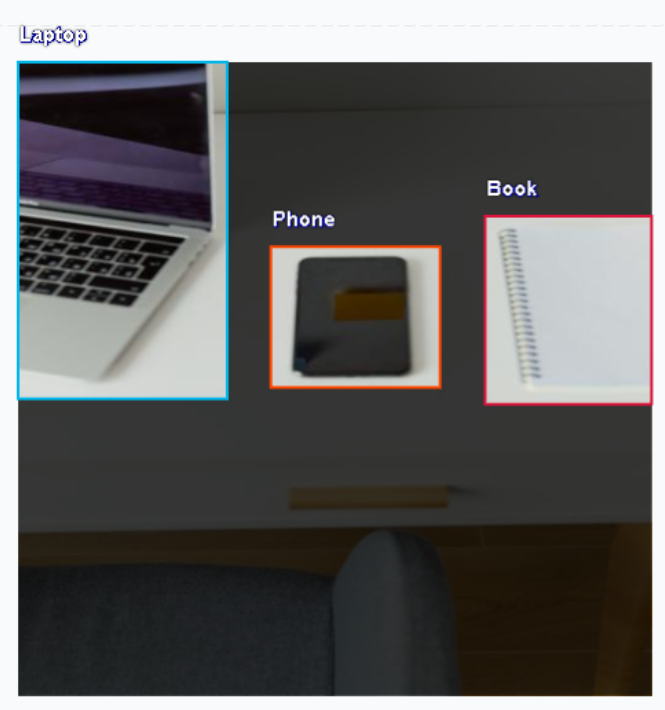
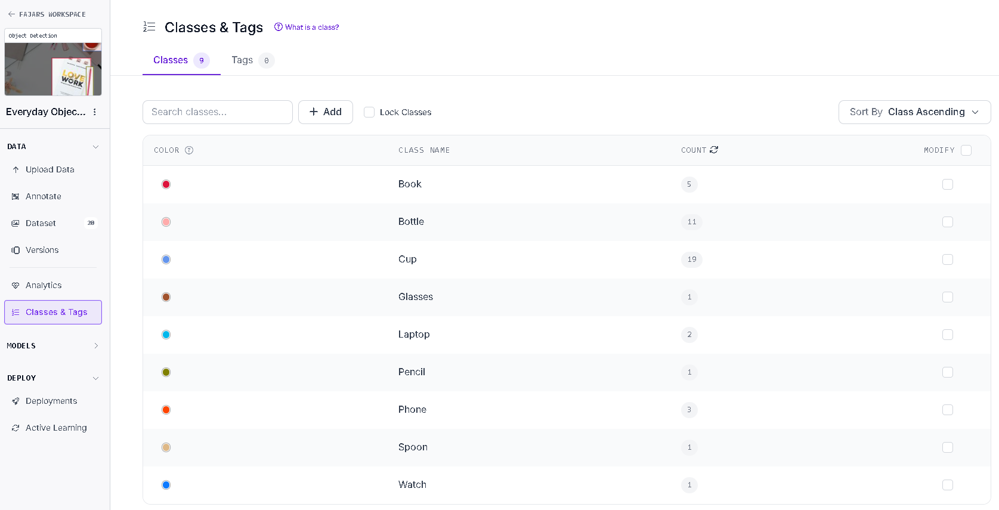

# Everyday Object Detection — Image Annotation Portfolio

## Project Overview
A personal portfolio project demonstrating manual image annotation using Roboflow.

## Tools
- Roboflow Annotate
- GitHub

## Dataset
- 20 images
- Object detection using bounding boxes
- 9 object classes

## Object Classes
- `book`
- `bottle`
- `cup`
- `glasses`
- `laptop`
- `pencil`
- `phone`
- `spoon`
- `watch`

## Workflow
1. Collected images for annotation practice.
2. Uploaded images to Roboflow.
3. Drew bounding boxes around visible target objects.
4. Assigned class labels consistently.
5. Reviewed annotations for accuracy.

## Quality Check
- Checked bounding box placement.
- Checked class label consistency.
- Avoided guessing unclear or heavily occluded objects.

## Screenshots

### Annotation Example

### Dataset Overview

### Object Classes

## Project Scope
This is a personal learning portfolio focused on image annotation and quality checking. Model training and deployment are outside the scope of this project.
