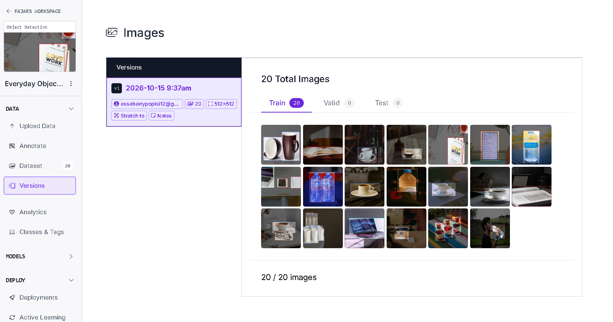

# Image Annotation Portfolio — Everyday Objects

## Project Overview

A personal portfolio project demonstrating manual image annotation using Roboflow. The project focuses on drawing bounding boxes around everyday objects and assigning appropriate class labels for object detection.

## Dataset

- 20 images
- 9 object classes
- Manual bounding box annotation
- Object class labeling

## Object Classes

- `book`
- `bottle`
- `cup`
- `glasses`
- `laptop`
- `pencil`
- `phone`
- `spoon`
- `watch`

## Workflow

1. Collected images for annotation practice.
2. Uploaded images to Roboflow.
3. Drew bounding boxes around visible target objects.
4. Assigned class labels consistently.
5. Reviewed annotations for accuracy.

## Quality Check

- Checked bounding box placement.
- Checked class label consistency.
- Avoided guessing unclear or heavily occluded objects.

## Examples

### Sample 1

**Bounding Box Annotation**

**Object Classes**

### Sample 2

**Bounding Box Annotation**

**Object Classes**

### Sample 3

**Bounding Box Annotation**

**Object Classes**

### Sample 4

**Bounding Box Annotation**

**Object Classes**

### Sample 5

**Bounding Box Annotation**

**Object Classes**

### Dataset Overview

## Tools

- Roboflow
- Pexels

## Project Scope

This is a personal learning portfolio focused on image annotation and quality checking. Model training and deployment are outside the scope of this project.
